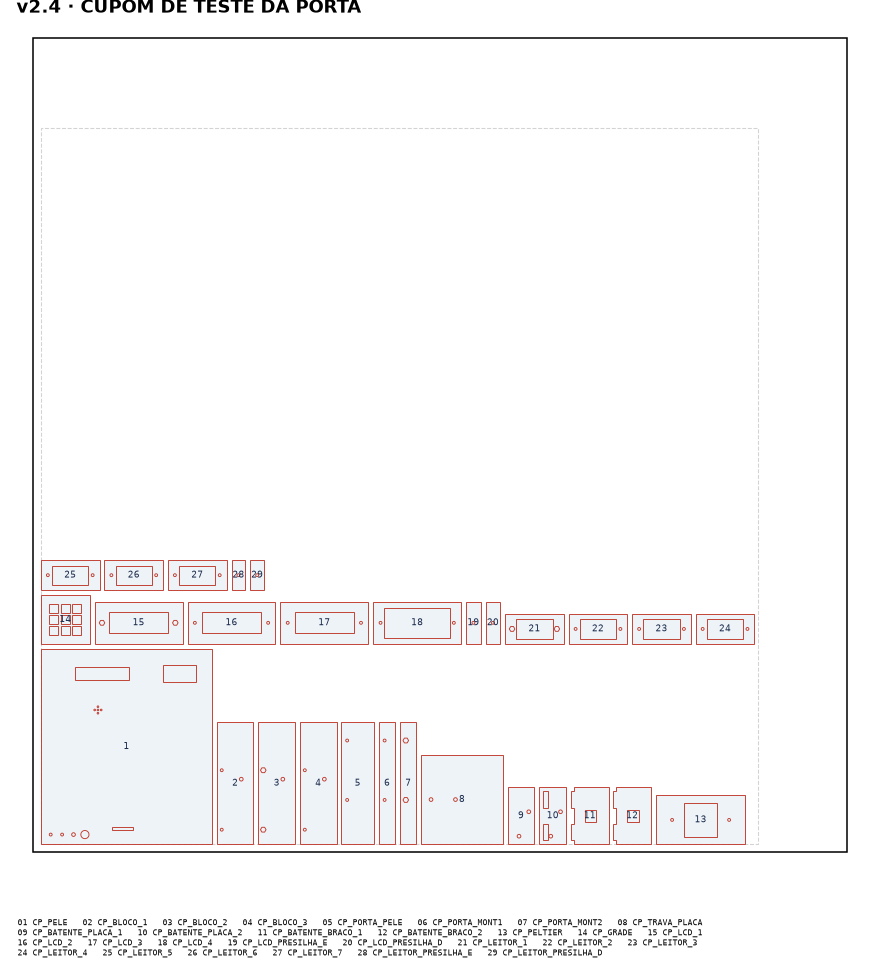
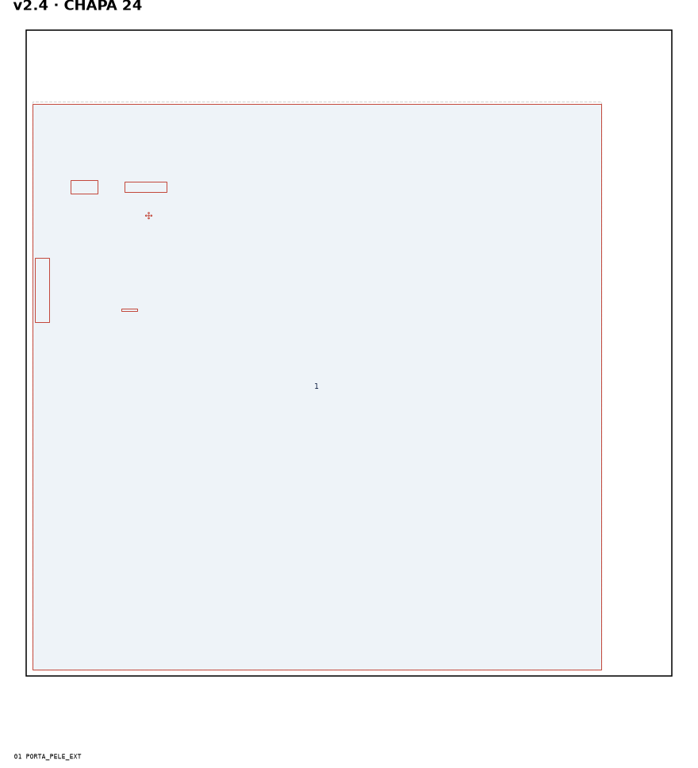
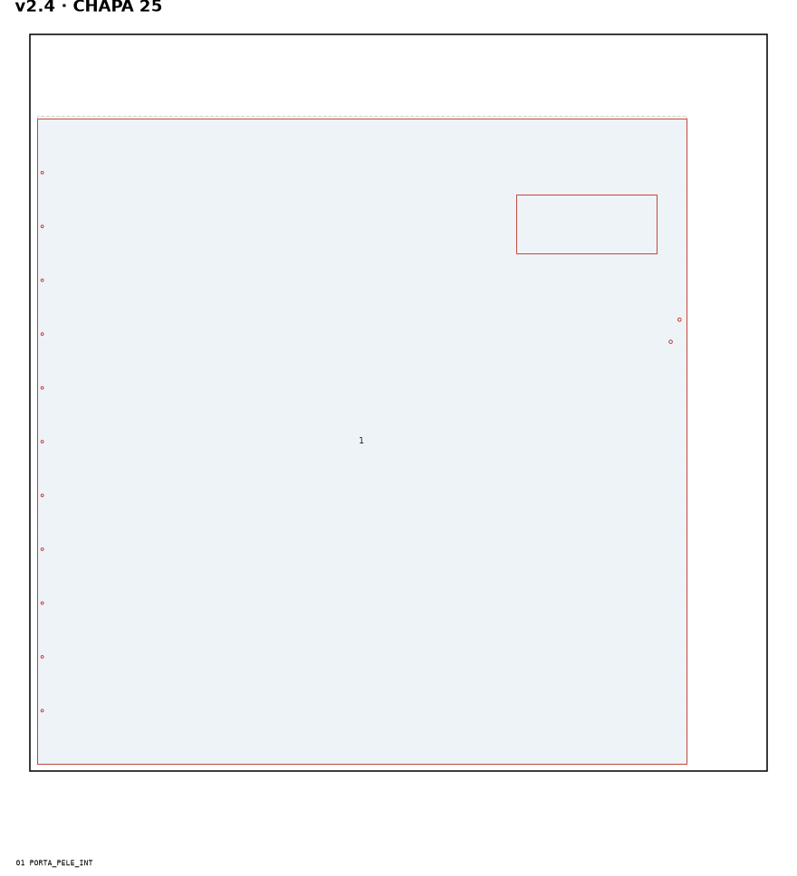
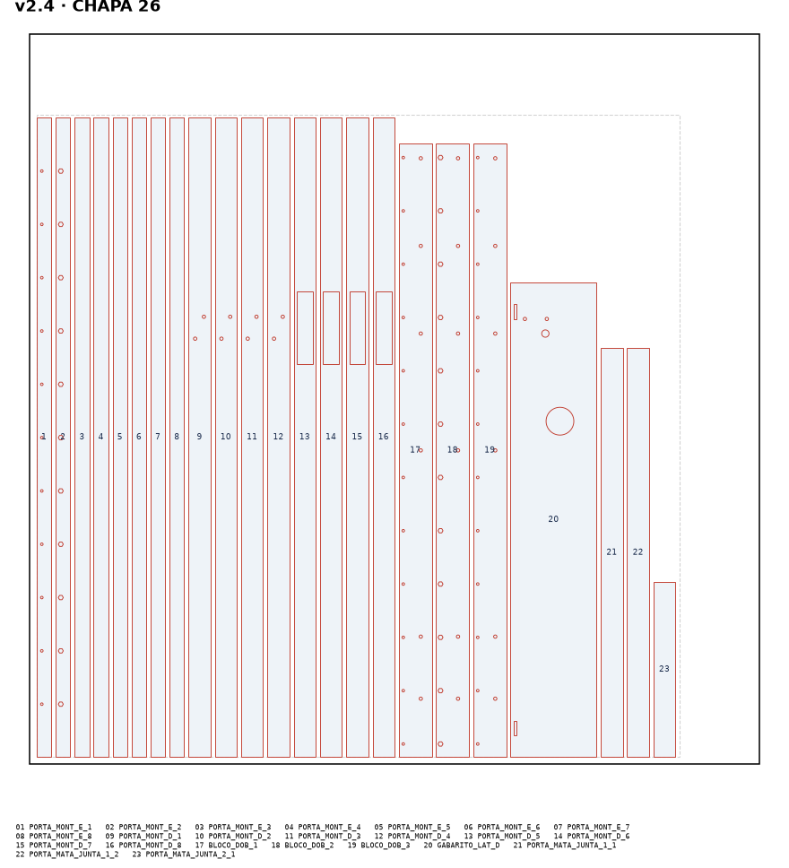
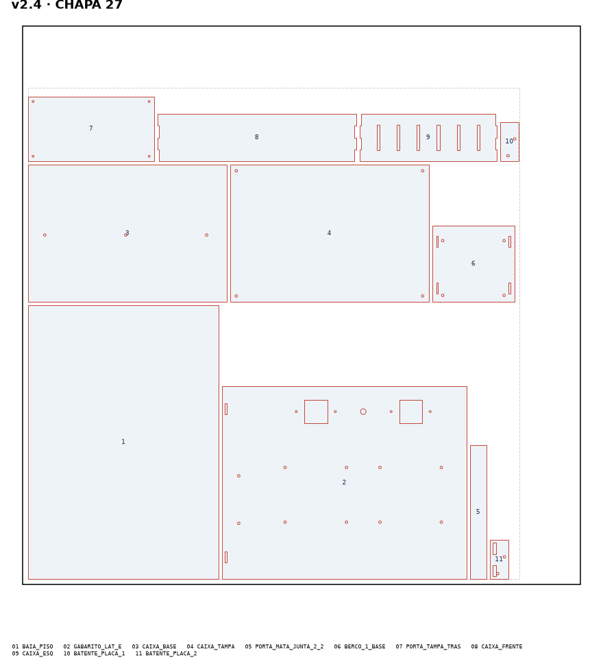
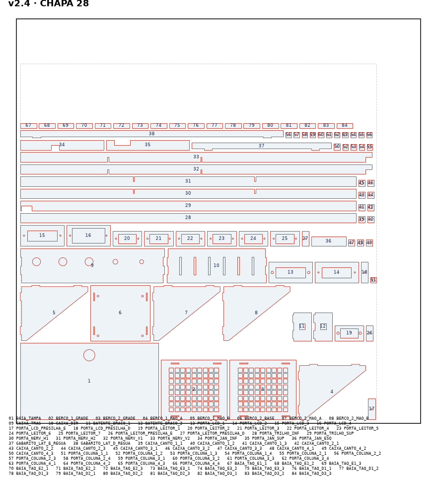
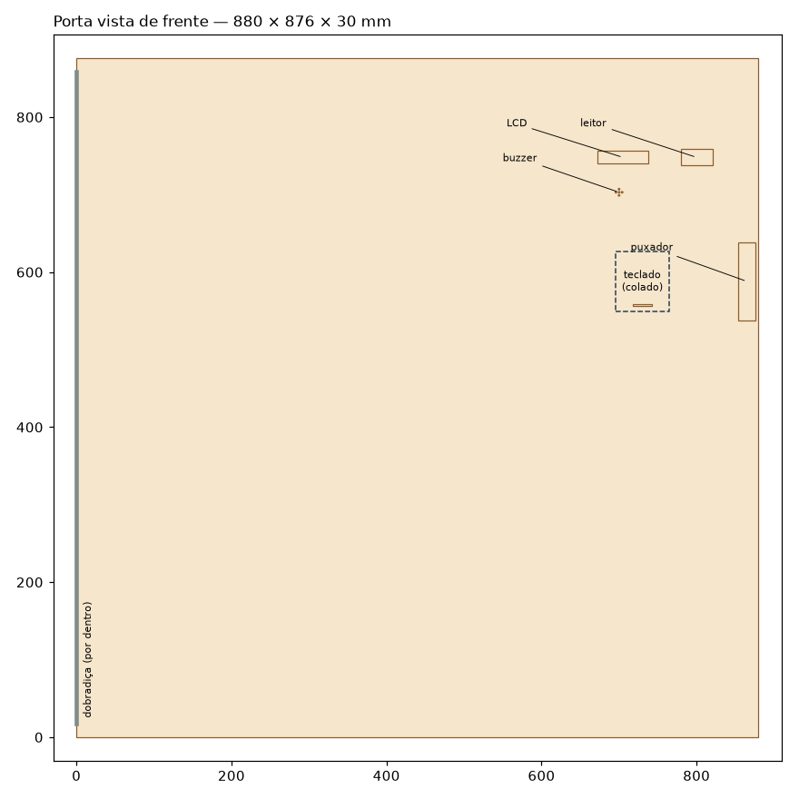
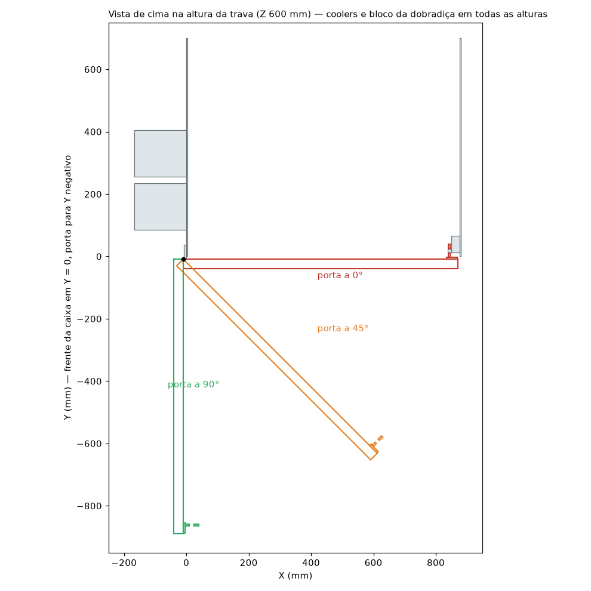

# Manual da porta e das peças novas (v2.4)

Gerado por `armario/gerador/porta_main.py`. Não edite à mão: mude o `config.py` e rode o gerador de novo.
Medidas em mm. Coordenadas do armário: olhando de frente, X para a direita, Y da frente para o fundo, Z para cima.

**Ordem obrigatória:**
1. Cortar o **cupom de teste** e testar.
2. Ajustar o `config.py` com o que foi medido.
3. Rodar o gerador de novo.
4. Só então cortar as chapas 24 em diante.

## 1. O que vai para a máquina

| Arquivo | Peças |
|---|---|
| `00_CUPOM_PORTA_CORTE.dxf` + `00_CUPOM_PORTA_NOMES.dxf` | Cupom de teste, 29 peças (cortar primeiro) |
| `corte/CHAPA_24.dxf` + `gravacao/CHAPA_24_NOMES.dxf` | 1 peça: PORTA_PELE |
| `corte/CHAPA_25.dxf` + `gravacao/CHAPA_25_NOMES.dxf` | 1 peça: PORTA_PELE |
| `corte/CHAPA_26.dxf` + `gravacao/CHAPA_26_NOMES.dxf` | 23 peças: BLOCO_DOB, GABARITO_LAT, PORTA_MATA, PORTA_MONT |
| `corte/CHAPA_27.dxf` + `gravacao/CHAPA_27_NOMES.dxf` | 11 peças: BAIA_PISO, BATENTE, BERCO_1, CAIXA_BASE, CAIXA_ESQ, CAIXA_FRENTE, CAIXA_TAMPA, GABARITO_LAT, PORTA_MATA, PORTA_TAMPA |
| `corte/CHAPA_28.dxf` + `gravacao/CHAPA_28_NOMES.dxf` | 84 peças: BAIA_TAMPA, BAIA_TAQ, BATENTE, BERCO_1, BERCO_2, CAIXA_CANTO, CAIXA_DIR, CAIXA_TRAS, GABARITO_LAT, PORTA_COLUNA, PORTA_JAN, PORTA_LCD, PORTA_LEITOR, PORTA_NERV, PORTA_TRILHO |

Valem as mesmas regras da V2.3:
- MDF de 3 mm, chapa de 1000 × 1000, área útil de 880 × 880 (peças entre 10 e 890), 6 mm entre peças.
- DXF em mm (INSUNITS = 4); corte em vermelho (ACI 1), gravação em azul (ACI 5).
- Folga de 0.10 mm por lado nos rasgos.

Os mapas de corte estão em `mapas/`; a lista completa de peças, em `LISTA_PECAS_PORTA.csv`.

## 2. Cupom de teste — o que conferir antes de cortar a porta

| Peças do cupom | Teste | Se não servir, mude no `config.py` |
|---|---|---|
| CP_PELE + CP_LCD_1 a 4 + presilhas | O LCD encaixa: o vidro aparece inteiro na janela de 66 × 16, a placa entra no rasgo da camada 4 e as presilhas apertam sem quebrar | `LCD_PLACA`, `LCD_MOLDURA`, `LCD_JANELA` |
| CP_PELE + CP_LEITOR_1 a 7 + presilhas | A face do AS608 encosta na janela de 41 × 21 e o dedo alcança a área de leitura inteira | `AS608_MODULO`, `AS608_JANELA` |
| CP_PELE (contorno gravado e rasgo) | O teclado cobre o contorno e o cabo flat passa no rasgo de 25 × 3 | `TECLADO`, `TECLADO_FLAT` |
| CP_PELE (furos pequenos) | Os furos de teste servem para a dobradiça (3,5), M3 e M4 sem forçar | `DOB_FURO`, `FURO_M3` e `FURO_M4` do `hardware/layout.py` |
| CP_BLOCO_1 a 3 + CP_PORTA_PELE/MONT1/MONT2 + 150 mm de dobradiça | Os furos da dobradiça batem com os do bloco (a cada 73 mm) e as porcas M3 ficam presas no sextavado | `DOB_PASSO`, `DOB_PRIMEIRO_FURO`, `DOB_FURO_DA_DOBRA`, `DOB_ABA_ESP` |
| CP_BATENTE_* + CP_TRAVA_PLACA + a trava FE-91 | Parafusar a trava na placa e montar o batente. Empurrando o batente contra a lingueta, ela recolhe e estala na janela; puxando, não sai; com 12 V, sai | `TRAVA_*`, `BATENTE_*` |
| CP_PELTIER | A pastilha entra no quadrado de 41 mm com folga pequena | `FURO_PELTIER` do `hardware/layout.py` |
| CP_GRADE | Um dedo não passa pelos quadrados de 11 mm | `BERCO_GRADE_FURO` |

## 3. A porta

- **Tipo:** porta-caixão, com duas peles de 3 mm e miolo de 24 mm. Uma folha só de 3 mm com 880 × 880 empenaria e não seguraria dobradiça nem trava.
- **Espessura e massa:** **30 mm** e **4.8 kg** sem componentes [calc, MDF a 750 kg/m³ est].
- **Tamanho:** 880 × 876 mm, de Z 2 a 878 e de X -10 a 870. A mata-junta (30 mm, sendo 10 mm para fora da porta) cobre a borda da lateral direita.
- **Folga até as gavetas:** a face de dentro da porta fechada fica em Y = -9. Com a frente das gavetas em Y = 0 (`FRENTE_GAVETA_Y`, valor calculado), sobram **9 mm**.
- **Puxadores das gavetas: só embutidos** (furo ou rasgo na frente). Nada pode sair mais que 4 mm da frente.
- **Medir antes de cortar:**
  1. Encoste uma régua nas bordas da frente das duas laterais.
  2. Meça quanto cada gaveta e cada prateleira fica para fora ou para dentro.
  3. Ponha o maior valor para fora (negativo) em `FRENTE_GAVETA_Y` e rode o gerador.
  O gerador recusa se a folga ficar abaixo de 5 mm.
- **O que fica no miolo:**
  - montante da dobradiça (8 camadas, porcas M3 presas na camada 2);
  - montante da trava (8 camadas, cava do puxador nas 4 de fora);
  - trilhos e nervuras em pé, encaixadas em meia-madeira;
  - moldura da janela de serviço;
  - molduras do LCD e do leitor, coladas na pele de fora;
  - canal dos cabos, no alto.
- **Janela de serviço:** a pele de dentro tem uma janela de 190 × 80 mm atrás do LCD e do leitor. Ela é fechada pela tampa traseira, presa por 4 parafusos M3 em colunas coladas.
- **Tampa traseira:** avança 15 mm para dentro do armário, na frente do compartimento entre a Prateleira 1 e o piso da câmera. **Deixem vazios os primeiros 10 mm dessa prateleira.**
- **Cabos:** correm no canal do alto do miolo e saem pela **borda de cima** da porta, a 22–48 mm da dobradiça. Dali, um laço de 15 cm até a caixa da eletrônica no tampo.

### Ordem de montagem da porta

1. Colar as camadas de cada montante (esquerdo 1→8, direito 1→8). No esquerdo, as porcas M3 já vão nos sextavados da camada 2.
2. Na pele de dentro, deitada com a face gravada para cima, colar:
   - os montantes;
   - os trilhos (o de cima com o entalhe da saída dos cabos junto da dobradiça);
   - as nervuras, encaixadas em meia-madeira;
   - a moldura da janela.
   Conferir o esquadro.
3. Na pele de fora, com a face gravada para cima (é o lado de dentro), colar as molduras do LCD (camadas 1–4) e do leitor (1–7), centradas nas janelas, com as porcas M3 nos sextavados da camada 1.
4. Passar os 3 cabos de rede pelo canal e pela saída de cima. Ligar o teclado pelo rasgo e deixar as pontas do LCD, do leitor e do buzzer na janela.
5. Fechar: cola em todas as nervuras e montantes, pele de fora por cima, peso espalhado por igual (livros) por 12 h.
6. Pela janela de serviço, montar o LCD e o leitor com as presilhas M3. Colar o buzzer atrás dos furinhos. Colar o teclado por fora.
7. Colar as 4 colunas da tampa traseira (a camada 1, com a porca, encostada na pele) e parafusar a tampa.
8. Colar a mata-junta (2 camadas, 2 trechos) na borda direita, por dentro, com 10 mm para fora da porta.

## 4. Dobradiça, batente, trava e liberação de emergência

- **Dobradiça piano:** cortada com 840 mm, de Z 20 a 860. Corte de modo que o 1º furo da aba do armário fique a 18 mm da ponta de baixo.
  - Aba do armário: **12 parafusos M3 × 10**, com as porcas presas no bloco.
  - Aba da porta: **11 parafusos M3 × 10**, com as porcas presas no montante.
- **Bloco da dobradiça** (3 camadas, 45 × 840):
  - colado na face de fora da lateral esquerda, com a frente 8 mm à frente da caixa;
  - preso por **6 parafusos M4 × 20** passantes, em Y 22 e Z 100, 185, 440, 600, 720, 840;
  - os furos de cima são feitos usando o próprio bloco como gabarito: fure pelos furos dele, já colado.
- **A porta abre até 90°** (a dobradiça chega a 180° entre as abas). Não force além: os coolers ficam do lado esquerdo.
- **Trava FE-91:** corpo na face de dentro da lateral direita, em Z 600. A lingueta aponta para o meio do armário (−X), com o lado chanfrado virado para a frente. As medidas da trava não são publicadas: meçam e ajustem `TRAVA_*` antes de cortar o cupom.
- **Batente:** placa de 2 camadas na face de dentro da porta e braço de 2 camadas com a janela da lingueta. Ao fechar, o braço empurra o chanfro e a lingueta estala na janela.
- **Liberação de emergência (sem energia):**
  1. Os 2 parafusos M4 × 30 que prendem o batente na porta entram pela **cava do puxador**.
  2. Com uma chave Phillips, solte os dois: a porta abre e o batente fica preso na trava.
  3. Para fechar de novo, recoloque o batente e aperte os parafusos.
  Testem isso no cupom e de novo na porta montada, antes da banca.
- **Reed:** na face de dentro da lateral direita, em Z 560, 6 mm atrás da borda. O ímã fica na mata-junta, na mesma altura.

## 5. Checagem de colisão

Giram junto com a porta, em torno do eixo da dobradiça: a própria porta, a mata-junta, a tampa traseira, o batente e o ímã.
O gerador confere a cada 1° de 0 a 15° e a cada 5° até 90° se alguma dessas partes encosta em:
- laterais, base, tampo, prateleiras e divisórias;
- frentes das gavetas e tampa da baia fria;
- trava, reed e câmeras;
- bloco da dobradiça, coolers, berços e caixa da eletrônica.

**Resultado: 0 colisões.** Menores folgas:

| Parte da porta | 0° | 45° | 90° |
|---|---|---|---|
| porta | 1 mm (bloco da dobradiça) | 1.4 mm (bloco da dobradiça) | 1.4 mm (bloco da dobradiça) |
| mata-junta | 3 mm (lateral direita) | 612.9 mm (tampo) | 861 mm (bloco da dobradiça) |
| tampa traseira | 29 mm (lateral direita) | 618.7 mm (lateral direita) | 633 mm (bloco da dobradiça) |
| placa do batente | 9 mm (reed) | 662.2 mm (lingueta) | 846 mm (bloco da dobradiça) |
| braço do batente (baixo) | 3 mm (corpo da trava) | 627.9 mm (lateral direita) | 851 mm (bloco da dobradiça) |
| braço do batente (cima) | 3 mm (corpo da trava) | 627.9 mm (lateral direita) | 851 mm (bloco da dobradiça) |
| braço do batente (antes da janela) | 1 mm (lingueta) | 651.3 mm (lingueta) | 851 mm (bloco da dobradiça) |
| braço do batente (depois da janela) | 1 mm (lingueta) | 624.9 mm (lingueta) | 851.3 mm (bloco da dobradiça) |
| ímã do reed | 2 mm (reed) | 668 mm (lateral direita) | 869 mm (bloco da dobradiça) |

A folga de 1 mm entre a porta fechada e o bloco é a espessura da aba da dobradiça, que fica entre eles.
A lingueta só entra na conta com a porta fechada: para abrir, a trava recolhe a lingueta.

## 6. Peças do armário

- **Gabaritos de furação** (`GABARITO_LAT_E`, `GABARITO_LAT_D`):
  1. Encaixe a régua de encosto nos rasgos do gabarito.
  2. Apoie a borda "MESA" na mesa e encoste a régua na borda da frente da lateral.
  3. Fure pelos furos do gabarito.
  4. Nos quadrados das Peltier: risque por dentro da janela, fure os cantos com broca de 10 mm e termine com estilete.
- **Berços dos coolers** (`BERCO_1_*`, `BERCO_2_*`): placa na lateral (4 parafusos M4 × 20 passantes), duas mãos-francesas encaixadas e a grade por cima. A ventoinha do cooler fica sobre a grade, soprando para cima.
- **Baia fria** (`BAIA_*`):
  - 6 taquinhos (3 camadas cada) colados pela frente, com a face de cima em Z 205; o piso desliza pela frente e apoia neles;
  - a tampa leva o bloco de EPS colado atrás e uma alça (furo de 28 mm);
  - isopor, cortado à mão em 50 mm:
    - piso: 343 × 444; teto: igual;
    - paredes laterais: 444 × 91, com entalhe de 13 mm onde passa corrediça;
    - fundo: 243 × 91;
    - bloco da tampa: 241 × 89;
    - na parede esquerda, furos quadrados de 39 mm no isopor, na frente dos furos das Peltier, para os espaçadores.
- **Caixa da eletrônica** (`CAIXA_*`):
  - 350 × 240 × 85 mm por dentro, juntas de dente coladas;
  - presa no tampo por 3 parafusos M4 (use a base como gabarito), em X 260, Y 430;
  - tampa com 4 parafusos M4 em cantos com porca presa;
  - **só abrir com a fonte fora da tomada.**

## 7. Estabilidade e fixação (RNF14)

- O armário pesa ≈ 21 kg [calc pela área das peças, MDF a 750 kg/m³ est]. A porta, com os componentes, ≈ 5.5 kg.
- Com a porta aberta a 90°, o momento que tomba para a frente é ≈ 2.4 kg·m, contra ≈ 8.4 kg·m que seguram (fator 3.4). **Sozinho, não tomba.**
- Mas alguém apoiando **10 kg** na ponta da porta aberta soma 8.9 kg·m: **tomba**.
- **Mínimo para a banca:** prender a base na mesa com 2 grampos sargento (os da oficina da faculdade), um em cada canto da frente.
- **Para a parede (RNF14, fora do protótipo):** 2 cantoneiras metálicas no tampo, parafusadas na parede, com parafuso passante e arruela larga no tampo.

