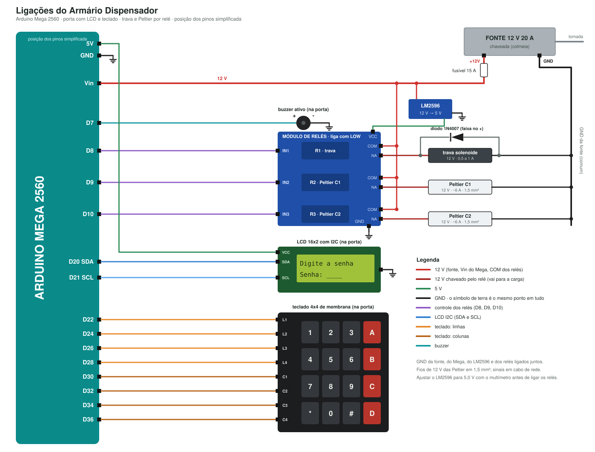
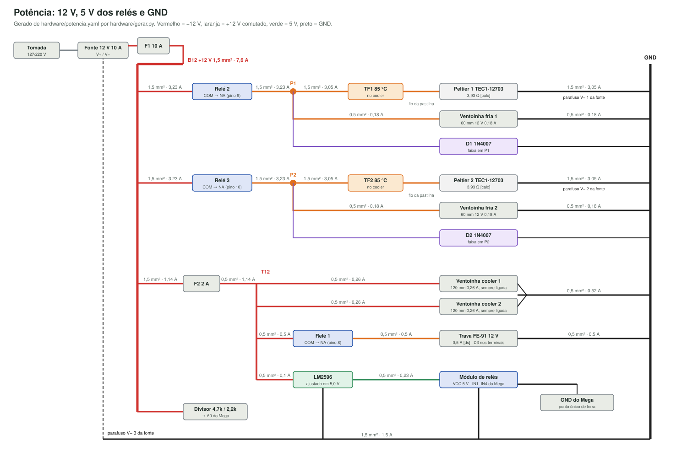

# Ligações

Como cada peça se liga e por onde passa cada fio. Vale para a arquitetura decidida em 22/10 (`docs/DECISOES.md`): Mega + notebook, baia fria na coluna A (no lugar de A3 e A4), duas TEC1-12703 atravessando a lateral esquerda com os coolers do lado de fora, e eletrônica numa caixa em cima do tampo.

**Pior caso de montagem:** o armário pode estar todo colado. Nada aqui exige desmontar ou recortar peça cortada; todos os furos são nas laterais, feitos por fora com gabarito. O vão de trás não é usado.

**De onde vêm as tabelas.** As tabelas de pinos, de potência e de furos são **geradas**:
- pinos: `hardware/pinos.yaml`
- fios de potência: `hardware/potencia.yaml`
- furos: `hardware/furos.py`, que calcula a partir do `armario/gerador/config.py`

Para mudar um pino, um fio ou um furo, mude o arquivo de origem e rode:

```bash
python hardware/gerar.py
```

O teste `pytest tests/test_pinos.py` falha se este documento, o `pinos.h` do firmware ou os diagramas ficarem diferentes dos arquivos de origem.

**Medidas.** Olhando o armário de frente, a partir do canto externo de baixo à esquerda, em mm: X para a direita, Y da frente para o fundo, Z para cima.

## 1. O que fica onde

| Lugar | O que fica lá |
|---|---|
| Porta | LCD 16x2, teclado 4x4, leitor de digital AS608 e buzzer passivo, com os fios correndo no canal interno da porta até a dobradiça (Fase 5) |
| Tampo, na frente, no meio | Webcam externa, olhando para quem está no teclado. O cabo vai por fora até o notebook |
| Tampo, atrás | **Caixa da eletrônica**: fonte, F1, F2, módulo de relés, LM2596, Mega e conectores de alavanca |
| Lateral direita, por dentro, na frente | Trava (Z 600) e reed do sensor de porta (Z 560, num taquinho de MDF que leva o reed até a borda da frente). O ímã e o batente ficam na porta (Fase 5) |
| Lateral direita, por dentro, Z 460 | Webcam interna, olhando para as gavetas |
| Coluna A, metade de cima (Z 205 a 399) | Baia fria: EPS de 50 mm, bandeja, 2 dissipadores frios com ventoinha, DS18B20 da baia, bandejinhas da água |
| Lateral esquerda, por fora | Dobradiça (no bloco de reforço, junto da frente); os 2 coolers Hyper 212 nos berços (Y 98 a 392, Z 238 a 336), cada um com fusível térmico e DS18B20 na base |
| Fora do armário | Notebook (USB do Mega e das 2 webcams) |

## 2. Diagramas





## 3. Pinos do Mega

O Mega é alimentado **pela USB do notebook**. O Vin fica sem nada. O módulo de relés liga com nível baixo: no firmware, cada saída recebe o nível inativo **antes** de `pinMode(OUTPUT)` (a lista `SAIDAS` do `pinos.h` serve para isso).

<!-- gerado:pinos -->
| Pino | Nome no firmware | Tipo | Liga em | Cabo | Observação |
|---|---|---|---|---|---|
| 8 | `PINO_RELE_TRAVA` | saída, ativo em baixo | IN1 do módulo de relés | jumper macho-fêmea | Relé 1: trava solenoide. digitalWrite(HIGH) antes de pinMode(OUTPUT) |
| 9 | `PINO_RELE_PELTIER_1` | saída, ativo em baixo | IN2 do módulo de relés | jumper macho-fêmea | Relé 2: Peltier 1 (X 110) + ventoinha fria 1 |
| 10 | `PINO_RELE_PELTIER_2` | saída, ativo em baixo | IN3 do módulo de relés | jumper macho-fêmea | Relé 3: Peltier 2 (X 240) + ventoinha fria 2 |
| 11 | `PINO_RELE_LIVRE` | saída, ativo em baixo | IN4 do módulo de relés | jumper macho-fêmea | Relé 4: sem carga. O firmware mantém desligado |
| 7 | `PINO_BUZZER` | saída, ativo em alto | Buzzer passivo (+) por resistor de 1 kΩ | cabo de rede 3 (8 fios, 3 sobrando) | Volume pelo ciclo de trabalho do PWM (RNF10). O (−) vai no GND do cabo |
| 3 | `PINO_SENSOR_PORTA` | entrada com pull-up, ativo em baixo | Reed MC-38 (o outro fio no GND) | fio do próprio MC-38 + emenda de 0,5 mm² | LOW = ímã perto = porta fechada. Fio rompido lê HIGH = aberta (falha segura) |
| 18 | `PINO_DIGITAL_TX` | serial | RX do AS608 por divisor 1 kΩ / 2,2 kΩ | cabo de rede 3 (8 fios, 3 sobrando) | TX1 do Mega. O divisor baixa 5 V para 3,4 V |
| 19 | `PINO_DIGITAL_RX` | serial | TX do AS608 | cabo de rede 3 (8 fios, 3 sobrando) | RX1 do Mega. Conferir na bancada que o TX do leitor chega a mais de 3,0 V |
| 38 | `PINO_LCD_RS` | saída, ativo em alto | RS do LCD 16x2 | cabo de rede 2 (8 fios) |  |
| 40 | `PINO_LCD_E` | saída, ativo em alto | E do LCD | cabo de rede 2 (8 fios) |  |
| 42 | `PINO_LCD_D4` | saída, ativo em alto | D4 do LCD | cabo de rede 2 (8 fios) |  |
| 44 | `PINO_LCD_D5` | saída, ativo em alto | D5 do LCD | cabo de rede 2 (8 fios) |  |
| 46 | `PINO_LCD_D6` | saída, ativo em alto | D6 do LCD | cabo de rede 2 (8 fios) |  |
| 48 | `PINO_LCD_D7` | saída, ativo em alto | D7 do LCD | cabo de rede 2 (8 fios) |  |
| 22 | `PINO_TECLADO_L1` | saída, ativo em baixo | Linha 1 do teclado (pino 1 do flat) | cabo de rede 1 (8 fios) |  |
| 24 | `PINO_TECLADO_L2` | saída, ativo em baixo | Linha 2 (pino 2) | cabo de rede 1 (8 fios) |  |
| 26 | `PINO_TECLADO_L3` | saída, ativo em baixo | Linha 3 (pino 3) | cabo de rede 1 (8 fios) |  |
| 28 | `PINO_TECLADO_L4` | saída, ativo em baixo | Linha 4 (pino 4) | cabo de rede 1 (8 fios) |  |
| 30 | `PINO_TECLADO_C1` | entrada com pull-up, ativo em baixo | Coluna 1 (pino 5) | cabo de rede 1 (8 fios) |  |
| 32 | `PINO_TECLADO_C2` | entrada com pull-up, ativo em baixo | Coluna 2 (pino 6) | cabo de rede 1 (8 fios) |  |
| 34 | `PINO_TECLADO_C3` | entrada com pull-up, ativo em baixo | Coluna 3 (pino 7) | cabo de rede 1 (8 fios) |  |
| 36 | `PINO_TECLADO_C4` | entrada com pull-up, ativo em baixo | Coluna 4 (pino 8) | cabo de rede 1 (8 fios) |  |
| 4 | `PINO_ONEWIRE` | 1-Wire | DQ dos 3 DS18B20 (amarelo), pull-up de 4,7 kΩ para 5 V | cabos dos DS18B20 (90 cm) + emenda de 0,5 mm² | Baia fria, cooler 1 e cooler 2 no mesmo fio; o firmware separa pelo endereço. Até ~2 m de cabo |
| A0 | `PINO_MEDE_12V` | analógica | Meio do divisor 4,7 kΩ (do +12 V) / 2,2 kΩ (do GND) | jumper macho-fêmea | 12 V -> 3,83 V. Abaixo de 9 V o firmware registra falta de energia |

| Do Mega | Liga em | Cabo | Observação |
|---|---|---|---|
| 5V | VDD do LCD, A (luz de fundo) por 220 Ω, potenciômetro de contraste | porta_2 |  |
| 5V | VCC do AS608 | porta_3 |  |
| 5V | VDD dos 3 DS18B20 (vermelho) e pull-up de 4,7 kΩ | sensores |  |
| GND | GND do LCD, do AS608 e do buzzer | porta_2 e porta_3 |  |
| GND | GND dos DS18B20 (preto) e do reed | sensores e reed |  |
| GND | GND do módulo de relés (ponto único de terra) | jumper | Único fio entre o terra do Mega e o terra do 12 V. Nenhuma corrente de carga passa por ele |

Pinos reservados: 0 (RX0 da USB (conversa com o notebook)); 1 (TX0 da USB (conversa com o notebook)); 13 (LED da placa; pisca no bootloader, não serve para relé).
<!-- /gerado:pinos -->

**Na porta, dentro da caixa traseira** (não passa pelo cabo):
- **LCD:** VSS, RW e K no GND; VDD no 5 V; A no 5 V por 220 Ω; V0 no meio do potenciômetro de 10 kΩ, com as pontas no 5 V e no GND.
- **AS608:** o TX do Mega passa por um divisor: 1 kΩ do fio do Mega até o RX do leitor e 2,2 kΩ do RX do leitor até o GND. Os resistores ficam emendados no próprio cabo, com termo-retrátil.
- **Buzzer passivo:** 1 kΩ em série no +.

## 4. Potência

<!-- gerado:potencia -->
| Trecho | De | Para | Fio | Corrente (pior caso) | Capacidade do fio | Protegido por | Observação |
|---|---|---|---|---|---|---|---|
| `tomada` | Tomada (fase, neutro, terra) | Fonte L, N e terra | 1 mm² | 1,5 A [calc] 120 W / 127 V / ~0,8 de eficiência | 6 A | disjuntor da tomada | Cabo tripolar. Terra ligado. Tampa sobre o borne se for a fonte colmeia |
| `fonte_f1` | Fonte V+ | F1 (10 A) | 1,5 mm² | 7,6 A [calc] docs/DECISOES.md 1.4 | 10 A | proteção interna da fonte |  |
| `f1_b12` | F1 | B12 | 1,5 mm² | 7,6 A [calc] | 10 A | F1 |  |
| `b12_rele2` | B12 | COM do relé 2 | 1,5 mm² | 3,23 A [calc] 3,05 + 0,18 | 10 A | F1 |  |
| `rele2_p1` | NA do relé 2 | P1 | 1,5 mm² | 3,23 A [calc] | 10 A | F1 |  |
| `p1_tf1` | P1 | TF1 | 1,5 mm² | 3,05 A [calc] 12 V / 3,93 Ω | 10 A | F1 |  |
| `tf1_peltier1` | TF1 | Peltier 1 (+, vermelho) | do próprio componente | 3,05 A [calc] | — | F1 | Queda nos 1,2 m de ida e volta em 1,5 mm²: 0,08 V [calc 2 × 0,0172 × 1,2 / 1,5 × 3,05] |
| `peltier1_gnd` | Peltier 1 (−, preto) | GND (parafuso V− 1 da fonte) | 1,5 mm² | 3,05 A [calc] | 10 A | F1 |  |
| `p1_vf1` | P1 | Ventoinha fria 1 (+) | 0,5 mm² | 0,18 A [ds] Eletrogate 180 mA | 3 A | F1 | Fio de 30 cm; ventoinha travada puxa < 0,3 A e num curto o F1 abre em menos de 1 s |
| `vf1_gnd` | Ventoinha fria 1 (−) | GND | 0,5 mm² | 0,18 A [ds] | 3 A | F1 | Fio de 30 cm; ventoinha travada puxa < 0,3 A e num curto o F1 abre em menos de 1 s |
| `b12_rele3` | B12 | COM do relé 3 | 1,5 mm² | 3,23 A [calc] 3,05 + 0,18 | 10 A | F1 |  |
| `rele3_p2` | NA do relé 3 | P2 | 1,5 mm² | 3,23 A [calc] | 10 A | F1 |  |
| `p2_tf2` | P2 | TF2 | 1,5 mm² | 3,05 A [calc] | 10 A | F1 |  |
| `tf2_peltier2` | TF2 | Peltier 2 (+, vermelho) | do próprio componente | 3,05 A [calc] | — | F1 |  |
| `peltier2_gnd` | Peltier 2 (−, preto) | GND (parafuso V− 2 da fonte) | 1,5 mm² | 3,05 A [calc] | 10 A | F1 |  |
| `p2_vf2` | P2 | Ventoinha fria 2 (+) | 0,5 mm² | 0,18 A [ds] | 3 A | F1 | Fio de 30 cm; ventoinha travada puxa < 0,3 A e num curto o F1 abre em menos de 1 s |
| `vf2_gnd` | Ventoinha fria 2 (−) | GND | 0,5 mm² | 0,18 A [ds] | 3 A | F1 | Fio de 30 cm; ventoinha travada puxa < 0,3 A e num curto o F1 abre em menos de 1 s |
| `b12_f2` | B12 | F2 (2 A) | 1,5 mm² | 1,14 A [calc] 0,5 + 0,52 + 0,10 + 0,02 | 10 A | F1 |  |
| `f2_t12` | F2 | T12 | 0,5 mm² | 1,14 A [calc] | 3 A | F2 |  |
| `t12_vq1` | T12 | Ventoinha do cooler 1 (+, pino 2) | 0,5 mm² | 0,26 A [ds] KaBuM 0,26 A | 3 A | F2 | Sempre ligada com a fonte: a Peltier nunca funciona sem ventoinha |
| `t12_vq2` | T12 | Ventoinha do cooler 2 (+, pino 2) | 0,5 mm² | 0,26 A [ds] | 3 A | F2 |  |
| `t12_rele1` | T12 | COM do relé 1 | 0,5 mm² | 0,5 A [ds] FE-91 0,5 A ([medir] bobina) | 3 A | F2 |  |
| `rele1_trava` | NA do relé 1 | Trava (+) | 0,5 mm² | 0,5 A [ds] | 3 A | F2 |  |
| `trava_gnd` | Trava (−) | GND | 0,5 mm² | 0,5 A [ds] | 3 A | F2 |  |
| `t12_lm` | T12 (pelo COM do relé 1, segundo fio) | LM2596 IN+ | 0,5 mm² | 0,1 A [calc] 0,23 A em 5 V / 12 V / 0,85 | 3 A | F2 |  |
| `lm_gnd` | LM2596 IN− | GND | 0,5 mm² | 0,1 A [calc] | 3 A | F2 |  |
| `lm_reles` | LM2596 OUT+ (5,0 V) | VCC do módulo de relés | 0,5 mm² | 0,23 A [ds] 3 bobinas de 70 Ω + LEDs | 3 A | F2 |  |
| `lm_reles_gnd` | LM2596 OUT− | GND do módulo de relés | 0,5 mm² | 0,23 A [calc] | 3 A | F2 |  |
| `vq_gnd` | Ventoinhas dos coolers (−, pino 1) | GND | 0,5 mm² | 0,52 A [ds] | 3 A | F2 |  |
| `gnd_fonte` | GND (conectores) | Fonte V− (parafuso 3) | 1,5 mm² | 1,5 A [calc] tudo menos as Peltier | 10 A | F1 |  |
| `mega_gnd` | GND do Mega | GND do módulo de relés | do próprio componente | 0,01 A [calc] só referência de sinal | — | - | Jumper. Único ponto entre o terra do Mega e o terra do 12 V |
| `divisor_12v` | B12 | 4,7 kΩ -> A0 -> 2,2 kΩ -> GND do Mega | do próprio componente | 0,002 A [calc] 12 / 6,9 kΩ | — | F1 |  |

| Fusível | Corrente | Tipo | Onde |
|---|---|---|---|
| F1 | 10 A | vidro 5x20 rápido, porta-fusível de meio de fio | logo no + da fonte |
| F2 | 2 A | vidro 5x20 rápido, porta-fusível de meio de fio | saída do barramento +12 V para o ramo fino. Se a bobina da trava medir ~6 Ω (2 A), trocar por fusível de 4 A |
| TF1 | 10 A, abre a 85 °C | fusível térmico, não rearmável | encostado na base do cooler 1 (pasta térmica, termo-retrátil no corpo, abraçadeira de metal); terminais emendados por luva de crimpar, sem solda |
| TF2 | 10 A, abre a 85 °C | fusível térmico, não rearmável | igual ao TF1, no cooler 2 |

| Diodo | Tipo | Entre | Por quê |
|---|---|---|---|
| D1 | 1N4007 | P1 (catodo, faixa) e GND (anodo) | Pico ao desligar a ventoinha fria 1 e os fios da Peltier |
| D2 | 1N4007 | P2 (catodo) e GND (anodo) | Idem para o ramo 2 |
| D3 | 1N4007 | Trava + (catodo) e trava − (anodo), nos terminais da trava | Bobina: sem o diodo o pico de tensão desgasta o contato do relé |

| Ponto de emenda | O que é |
|---|---|
| B12 | Barramento +12 V: conectores de alavanca de 3 vias em cadeia, ligados por fio de 1,5 mm² |
| T12 | Ramo fino +12 V (depois do F2): conector de alavanca de 3 vias |
| P1 | Saída do relé 2: conector de 3 vias (Peltier 1 + ventoinha fria 1 + diodo) |
| P2 | Saída do relé 3: conector de 3 vias (Peltier 2 + ventoinha fria 2 + diodo) |
| GND | Terra: parafusos V− da fonte + conectores de alavanca de 3 vias em cadeia |
| V5 | 5,0 V do LM2596 para o módulo de relés |
<!-- /gerado:potencia -->

### Como montar os barramentos (sem solda), dentro da caixa da eletrônica

1. **+12 V (B12).** Fonte V+ → porta-fusível F1 → conector de alavanca de 3 vias. Daí, conectores de 3 vias em cadeia, ligados entre si por pedaços de fio de 1,5 mm². Cada conector recebe no máximo 3 fios. Do B12 saem os COM dos relés 2 e 3 (1,5 mm²), o F2 (1,5 mm²) e o divisor do 12 V.
2. **Ramo fino (T12).** Saída do F2 → conector de 3 vias com as duas ventoinhas dos coolers → segundo conector com o COM do relé 1 e o IN+ do LM2596.
3. **GND.** As Peltier voltam direto nos parafusos V− da fonte (um parafuso para cada). Todo o resto (ventoinhas, trava, LM2596, diodos) vai para uma cadeia de conectores de 3 vias, ligada no terceiro parafuso V− por fio de 1,5 mm².
4. **GND do Mega.** **Um** jumper do GND do Mega ao GND do módulo de relés, e só ele. O 5 V do Mega não se liga a nada do lado de 12 V.
5. **Ventoinhas dos coolers** (conector de 4 pinos): pino 1 = GND (preto), pino 2 = +12 V (amarelo ou vermelho). Os pinos 3 e 4 ficam soltos; sem sinal de PWM, a ventoinha gira no máximo. Encaixe um jumper fêmea em cada pino e leve a ponta macho até o conector de alavanca.
6. **Fusível térmico:** os dois terminais vão para os fios por **luva de emenda crimpada** (alicate de crimpar), nunca solda.

## 5. Cabos e caminhos

Tudo corre por fora do armário, preso com abraçadeiras em bases adesivas, até a caixa da eletrônica no tampo.

| Cabo | Liga | Caminho |
|---|---|---|
| Cabos de rede 1, 2 e 3 | Porta → caixa da eletrônica | Canal interno da porta até a dobradiça. Laço de folga de 15 cm na dobradiça, por fora. Sobem pela quina da frente-esquerda até o tampo e vão até a caixa |
| Peltier, ventoinhas e DS18B20 dos coolers | Coolers → caixa | Sobem pela face de fora da lateral esquerda, atrás dos coolers (Y ~450), até o tampo |
| DS18B20 da baia e ventoinhas frias | Baia → caixa | Furo de 10 mm na lateral esquerda entre os coolers (Y 245, Z 300); depois sobem junto com os fios dos coolers |
| Trava e reed | Lateral direita → caixa | Por dentro, pela face da lateral direita, até o furo de 10 mm (Y 40, Z 580). Depois sobem por fora da lateral direita até o tampo. Diodo D3 nos terminais da trava |
| Webcam interna | → notebook | Furo de 38 mm na lateral direita (Y 60, Z 460); o plugue USB passa pelo furo |
| USB do Mega | Caixa → notebook | Direto |
| Webcam externa | Tampo → notebook | Por fora, sem furo |
| Tomada | → caixa | Pela traseira da caixa, com passa-fio |

## 6. Furos para fazer à mão

Todos nas duas laterais, **pela face de fora**, com o armário montado. As posições são marcadas com os gabaritos cortados a laser (Fase 5), que se apoiam na mesa e na borda da frente da lateral.
- Os quadrados de 41 mm das Peltier: broca de 10 mm nos 4 cantos de dentro do quadrado e estilete pela janela do gabarito.
- Os furos redondos: broca do diâmetro indicado. O de 38 mm, com a serra copo.

## 6. Furos para fazer à mão

Todos em peças já cortadas: só furos, sem recortar contorno. Os dois furos quadrados de 40 mm das Peltier são feitos com broca nos cantos e estilete, pela frente, com a gaveta tirada. Os de 38 mm, com a serra copo da lista antiga.

<!-- gerado:furos -->
| Lateral | Y (da frente) | Z (de baixo) | Tamanho | Para |
|---|---:|---:|---|---|
| lateral esquerda | 160 | 300 | 41 × 41 mm (quadrado) | Peltier 1 (quadrado) |
| lateral esquerda | 125 | 300 | Ø 3,5 mm | prensa da Peltier 1 (M3) |
| lateral esquerda | 195 | 300 | Ø 3,5 mm | prensa da Peltier 1 (M3) |
| lateral esquerda | 105 | 102 | Ø 4,5 mm | suporte do cooler 1 (M4) |
| lateral esquerda | 105 | 200 | Ø 4,5 mm | suporte do cooler 1 (M4) |
| lateral esquerda | 215 | 102 | Ø 4,5 mm | suporte do cooler 1 (M4) |
| lateral esquerda | 215 | 200 | Ø 4,5 mm | suporte do cooler 1 (M4) |
| lateral esquerda | 330 | 300 | 41 × 41 mm (quadrado) | Peltier 2 (quadrado) |
| lateral esquerda | 295 | 300 | Ø 3,5 mm | prensa da Peltier 2 (M3) |
| lateral esquerda | 365 | 300 | Ø 3,5 mm | prensa da Peltier 2 (M3) |
| lateral esquerda | 275 | 102 | Ø 4,5 mm | suporte do cooler 2 (M4) |
| lateral esquerda | 275 | 200 | Ø 4,5 mm | suporte do cooler 2 (M4) |
| lateral esquerda | 385 | 102 | Ø 4,5 mm | suporte do cooler 2 (M4) |
| lateral esquerda | 385 | 200 | Ø 4,5 mm | suporte do cooler 2 (M4) |
| lateral esquerda | 245 | 300 | Ø 10 mm | fios do DS18B20 da baia e das ventoinhas frias |
| lateral esquerda | 22 | 100 | Ø 4,5 mm | bloco da dobradiça (M4) |
| lateral esquerda | 22 | 185 | Ø 4,5 mm | bloco da dobradiça (M4) |
| lateral esquerda | 22 | 440 | Ø 4,5 mm | bloco da dobradiça (M4) |
| lateral esquerda | 22 | 600 | Ø 4,5 mm | bloco da dobradiça (M4) |
| lateral esquerda | 22 | 720 | Ø 4,5 mm | bloco da dobradiça (M4) |
| lateral esquerda | 22 | 840 | Ø 4,5 mm | bloco da dobradiça (M4) |
| lateral direita | 12 | 600 | Ø 4,5 mm | fixação da trava (M4) [medir na trava] |
| lateral direita | 42 | 600 | Ø 4,5 mm | fixação da trava (M4) [medir na trava] |
| lateral direita | 40 | 580 | Ø 10 mm | fios da trava e do reed |
| lateral direita | 60 | 460 | Ø 38 mm | cabo USB da câmera interna (plugue passa) |
<!-- /gerado:furos -->

## 7. Montagem da Peltier (cada uma das duas)

De dentro da baia para fora:

1. **Dissipador frio** 65 × 46 × 24 com a ventoinha de 60 mm, aletas para dentro da baia.
2. Pasta térmica.
3. **Espaçador** de alumínio 38,1 × 38,1 × 50 mm, atravessando o EPS da parede esquerda por um furo quadrado no EPS.
4. Pasta térmica.
5. **Pastilha TEC1-12703** dentro do furo quadrado da lateral, com a face **fria** virada para dentro. Para saber qual é a face fria [medir]: ligue a pastilha por 2 s numa fonte de 5 V e veja qual lado esfria.
6. Pasta térmica.
7. **Cooler Hyper 212** do lado de fora: base na pastilha, heat pipes para fora, ventoinha **embaixo** soprando para cima, apoiado no berço já parafusado.
8. **Prensa:** 2 barras roscadas M3 nos furos de 3,5 mm (Y ± 35 mm do centro). Por fora, uma barra chata sobre a base do cooler; por dentro, uma placa de MDF de sobra sobre o dissipador frio. Apertar as porcas alternando os lados, meia volta de cada vez, até o conjunto não mexer. **Aperto demais quebra a cerâmica da pastilha.**
9. **Fusível térmico e DS18B20 do cooler:** encostados na base do cooler, com pasta térmica e abraçadeira de metal. O corpo do fusível vai coberto com termo-retrátil (ele é ligado a um dos terminais).

## 8. Ordem de montagem

1. Fazer todos os furos da seção 6 com os gabaritos, por fora.
2. Montar os berços e parafusar na lateral esquerda.
3. Montar a baia fria pela frente: taquinhos, piso, EPS colado (com entalhe onde passa corrediça) e emendas fechadas com fita metalizada.
4. Testar cada Peltier na bancada antes de montar no armário (`docs/TESTES_DE_BANCADA.md`, passo 7). Depois montar as duas (seção 7).
5. Montar a caixa da eletrônica e, dentro dela, o +12 V e o GND (seção 4), **sem** ligar a fonte na tomada.
6. Passar os cabos da porta, da trava e dos coolers até a caixa.
7. Seguir o roteiro de testes de bancada do primeiro passo ao último.

Antes de ligar na tomada: `docs/SEGURANCA.md`.
